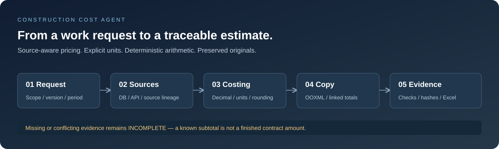
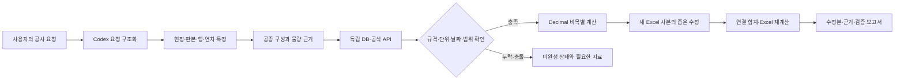

# Construction Cost Agent

### 근거를 남기는 건설 적산 AI 워크플로

**공사 요청을 물량·단가·Excel 수정본으로 연결하고, 계산에 사용한 출처와 검증 범위를 함께 남기는 개인 프로젝트입니다.**



[전체 맥락](docs/context.md) · [아키텍처](docs/architecture.md) · [실제 사례](docs/case-study.md) · [검증과 한계](docs/validation.md) · [SK AIGEN 포트폴리오](docs/portfolio.md)

| 프로젝트 | 내용 |
|---|---|
| 출발점 | 건축 내역서에 공종 하나를 추가할 때 단가 근거와 여러 시트의 연결금액까지 확인해야 하는 문제 |
| 핵심 사용자 | Excel 내역서와 PDF·CAD 자료로 공사비를 검토하는 사람 |
| 접근 | Codex가 요청과 도구 실행을 조율하고, 규칙과 Decimal 계산기가 수치를 처리 |
| 주요 기술 | Python, SQLite, Decimal, 제한된 AST 산식, OOXML, 공식 API, Windows Excel COM |
| 공개 범위 | 실제 엔진 소스 23개, 업무·설계 문서, 합성 자료로 실행하는 축소 데모와 테스트 |
| 상태 | 로컬 선택 범위 구현·검증. 전체 현장 자동 적산과 상용 서비스는 후속 과제 |

## 해결하려는 문제

“지붕에 12mm 내수합판 설치를 추가”하는 요청에는 금액 계산보다 먼저 풀어야 할 문제가 있습니다.

1. 비슷한 품명 중 두께·등급·단위·공급 범위가 맞는 가격을 찾습니다.
2. 자재 공급가격과 설치에 필요한 노무·공구비를 나눠 확인합니다.
3. 총괄과 연차별 물량, 숨겨진 행, 다른 시트의 집계를 추적합니다.
4. 수정한 숫자의 근거와 확인하지 못한 조건을 남깁니다.
5. 원본을 보존하고, 독립 계산과 실제 Excel 재계산을 대조합니다.

이 프로젝트는 이 과정을 반복 가능한 요청·계산·검증 흐름으로 묶습니다. 가격을 찾지 못했거나 규격이 충돌한 항목은 `INCOMPLETE`로 남기며, 확인한 부분합을 전체 금액처럼 표시하지 않습니다.

## 실행해 보기

공개 데모는 **Python 3.10 이상, 표준 라이브러리만** 사용합니다. API 키나 Excel 설치가 필요하지 않습니다.

```bash
git clone https://github.com/gimd34939-jpg/construction-cost-agent.git
cd construction-cost-agent
python -m demo
python -m unittest discover -s tests -v

# 새 폴더에 합성 원본·수정본 XLSX와 검증 JSON 생성
python -m demo --output demo-output
```

| 데모에서 확인할 결과 | 값 |
|---|---:|
| 합성 12mm 합판 설치 1㎡ 직접단가 | 31,345원 |
| 합성 공급가격 12,000 → 13,000원 변경 후 | 32,406원 |
| 가격 누락 | `INCOMPLETE`, 전체 금액 `null`, 확인된 부분합 별도 |
| XLSX 사본 검증 | 원본 SHA256·수식 보존, 연결값 9셀 독립 계산 대조 |

**위 금액과 계수는 `SYNTHETIC / DEMO_ONLY` 합성값입니다.** 현재 공표가격이나 실제 견적이 아닙니다. 공개 데모의 OOXML 검사는 실제 Microsoft Excel 재계산 검증과 구분합니다.

공개 데모는 이번 포트폴리오를 위해 만든 축소 구현입니다. 실제 엔진 전체와 동일한 프로그램으로 소개하지 않으며, 원래 구현은 [engine/](engine/)에서 확인할 수 있습니다.

## 구현 흐름



### 설계에서 중요하게 본 점

| 판단 | 구현에서의 대응 |
|---|---|
| 내역서에 있던 가격이 곧 신규가격은 아님 | `EXTERNAL_PRIMARY` 정책과 출처 계보 검사 |
| API 응답 성공만으로 가격 적용을 확정할 수 없음 | 날짜·규격·세금·납품조건·공급/설치 범위 매핑 |
| 숫자가 없는 상태와 0원은 다름 | `null`·미확정 사유·`known_subtotal` 구분 |
| 원 단위 절사 순서가 결과에 영향을 줌 | Decimal과 비목별 명시적 절사 |
| 파일 저장 성공과 계산 검증은 다름 | 독립 계산·저장 수식·별도 Excel 재계산 대조 |
| 원본 오류를 수정 성과로 오인하면 안 됨 | 전후 SHA와 기존 오류·새 오류 구분 |

## 실제 사용 사례

[내수합판 사례](docs/case-study.md)에서는 2026-10-06 조달청 API에서 규격에 맞는 합판 공급 참고가격을 조회하고 설치 일위대가를 별도로 구성했습니다.

- 당시 확인한 공급 참고가격: **11,554원/㎡**, 2026-10-01 공표, 부가세 별도·현장도착도
- 당시 설치 직접단가 추정: **31,092원/㎡**, 제경비·이윤·부가세 별도
- 손실·고정재 각 3%와 벽체합판 작업조의 지붕 준용은 **작성자 가정**으로 표시
- 독립 계산·저장값·실제 Excel의 **16개 셀과 가격 변화 1개 조건**을 확인한 기록

이 수치는 당시 조회와 가정의 기록입니다. 공개 데모의 합성가격과 다르며, 이후 날짜의 최신가격이나 승인단가로 제시하지 않습니다.

## 검증은 범위를 나눠 설명합니다

| 구분 | 확인된 기록 |
|---|---|
| 이번 공개 데모 | 로컬 `unittest` 25개 통과. 합성 가격·단위·기간·누락·원본 보존·수식 연결 검사 |
| 2026-10-06 외부 원장 | 시설자재 406,098행 원문 대응 대조, 불일치 0 기록 |
| 과거 개별 시험 | 원장 29건, API 계약 33건, 가격정책 70건 통과 기록 |
| 실제 Excel 사례 | 내수합판 16셀·가격 변화 1개 조건의 별도 재계산 기록 |

과거 검증을 이번 공개 저장소에서 다시 수행한 것으로 표시하지 않습니다. 데이터 수입 일치성은 현장 적합성·최신가격 완비·전체 공사비 정확도를 뜻하지 않습니다. CI는 공개 합성 데모만 실행합니다. [검증 경계와 남은 과제](docs/validation.md)를 함께 확인해 주세요.

## AI 활용과 본인의 역할

이 프로젝트는 **문제 정의와 검증 조건을 주도하고 Codex와 협업해 구현한 프로젝트**입니다. 공종의 추가 범위, 필요한 결과, 추정 허용 조건, 다른 시트까지 반영되어야 한다는 요구를 구체화하고 결과에 피드백을 주었습니다. Codex는 코드 구현·자료 조회·구조화 입력·실행·문서화와 검증을 보조했습니다.

금액은 LLM이 추측해서 확정하지 않고 규칙 기반 계산기가 처리합니다. 자체 모델 학습, 별도 LLM 추론 서버, 벡터 검색 서비스는 구현 범위에 없습니다. 개인별 코드 기여율과 시간·비용 절감률도 측정하지 않았습니다.

## 저장소 구성

```text
construction-cost-agent/
├── README.md                 # 프로젝트 개요와 실행 안내
├── demo/                     # 표준 라이브러리 기반 공개 축소 데모
│   └── fixtures/             # 합성 요청·가격
├── engine/                   # 실제 구현의 익명화한 핵심 소스
├── tests/                    # 공개 데모의 동작·실패조건 검증
├── docs/                     # 업무 맥락·구조·사례·검증·포트폴리오
├── assets/                   # 직접 작성한 시스템 설명 그림
└── .github/workflows/ci.yml   # 합성 데모 CI
```

실제 DB·현장 문서·API 응답·인증정보는 포함하지 않습니다. 전체 로컬 CLI에는 별도의 자료와 Windows Excel 등 실행 조건이 필요합니다. [실제 엔진의 실행 범위](engine/README.md)와 [공개 범위](NOTICE.md)에 정리했습니다.

## 다음 개선

- 다른 시트·숨김 행·총괄/연차까지 포함하는 작업별 의존관계 검증 강화
- 현장별 자동 물량의 정답 자료를 만들고 검증 기준을 공개 가능한 형태로 정리
- 현장 계수와 공식가격 갱신 상태를 사람이 이해하기 쉬운 화면으로 제공
- 실제 사용자 검토를 통해 작업시간·재작업률을 측정

프로젝트를 만든 전체 맥락과 SK AIGEN 지원 시 설명할 문제 해결 과정을 [포트폴리오 문서](docs/portfolio.md)에 첨부했습니다.
