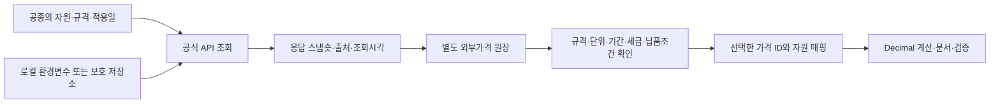

# 사용한 API와 인증키 연동

## 데이터베이스에 API를 더한 이유

표준품셈을 구조화하면 작업에 필요한 자원의 종류와 수량, 계산 조건을 찾을 수 있다. 그러나 품셈 계수만으로 해당 날짜의 자재 공급가격이나 유류가격을 알 수는 없다. 저장된 자료에 가격이 없거나 갱신이 필요한 경우를 보완하기 위해 조달청과 오피넷의 공식 API를 연결했다.

API는 데이터 구축과 검증 흐름 안에 들어간다. 요청에 맞는 품목을 조회한 뒤 규격·단위·날짜·세금·납품조건을 확인하고 선택한 가격을 계산 자원에 연결한다. 원문 응답과 조회시각, 출처 해시는 별도 외부가격 원장에 보관한다.

## 연결한 서비스

| 코드 | 서비스와 공식 안내 | 이 시스템에서 쓰는 정보 |
|---|---|---|
| `PPS_PRICE` | [조달청 나라장터 가격정보현황](https://www.data.go.kr/data/15129415/openapi.do) | 건축·토목·기계설비 시설공통자재의 공급 참고가격 |
| `PPS_SHOPPING` | [나라장터 쇼핑몰 품목정보](https://www.data.go.kr/data/15129471/openapi.do) | MAS·일반단가·제3자단가의 가격과 계약·납품 조건 |
| `PPS_CATALOG` | [물품목록정보](https://www.data.go.kr/data/15129417/openapi.do) | 물품식별번호와 품목 규격·속성. 가격은 제공하지 않는 경로 |
| `OPINET` | [오피넷 유가정보 API](https://www.opinet.co.kr/user/custapi/custApiInfo.do) | 전국·시도별 및 최근 기간의 유종별 평균가격 |

시설자재 공표가격은 현장별 견적과 구별하고, 쇼핑몰 가격은 계약기간과 지역·납품조건을 확인한다. 물품목록의 규격 조회 결과에서 가격을 만들어 내지 않는다. 오피넷 평균유가는 장비의 시간당 운전비 전체가 아니므로 장비비로 바로 대체하지 않는다.

## 실제 사용한 키의 종류와 설정

| 발급처 | 코드의 공급자 설정 | 환경변수 | 사용처 |
|---|---|---|---|
| 공공데이터포털·조달청 | `PPS` | `DATA_GO_KR_SERVICE_KEY` | 위 조달청 3개 서비스의 인증에 사용하는 키 설정 |
| 오피넷 | `OPINET` | `OPINET_API_KEY` | 유가정보 요청 인증 |

이 표는 실제 사용한 인증 방식과 설정명을 설명한다. 키 문자열 자체는 공개 자료에 넣지 않는다. 서비스별 활용 신청과 권한은 각 발급처에서 관리한다.

[api_credentials.py](../engine/api_credentials.py)는 먼저 해당 환경변수를 읽고, 없으면 로컬 Windows 사용자 DPAPI로 보호한 저장값을 읽는다. 키를 DB 원문이나 계산 결과에 기록하지 않는 구조다. 키 저장 코드와 실제 키 저장소는 구별되며, 이 저장소에 포함된 것은 구현 코드와 비어 있는 [환경변수 예시](../.env.example)다.

### Windows 로컬 등록

전체 로컬 엔진에 필요한 자료와 환경을 준비한 뒤 다음 명령으로 숨김 입력을 사용한다.

```powershell
python engine/api_credentials.py register --provider PPS
python engine/api_credentials.py register --provider OPINET
python engine/codex_cli.py api status
```

환경변수를 직접 설정해 사용할 수도 있다. `.env.example`은 변수 이름을 보여 주는 참고 파일이며, 현재 엔진에 `.env` 자동 로딩 기능이 있는 것은 아니다. `api status`는 등록 상태와 마지막 확인 기록을 보여 주며 새 가격을 조회하는 명령은 아니다.

## 가격을 계산에 연결하는 흐름



- [api_clients.py](../engine/api_clients.py): 공급처·API 작업별 호출과 JSON/XML 응답 처리
- [external_store.py](../engine/external_store.py): 스냅숏·가격·판본·출처 계보 저장
- [external_pricing.py](../engine/external_pricing.py): `api_price_id`·`api_mapping`으로 자원과 가격의 의미를 연결
- [pricing_policy.py](../engine/pricing_policy.py): 독립 외부가격 우선, 과거 내역서 가격의 자동 대체 제한

계산 시의 `CURRENT_REFRESH`와 기존 결과의 `SNAPSHOT_REPLAY`는 다른 작업이다. API 조회가 실패하거나 조건이 맞지 않으면 부족한 자료를 표시한다. API로 모든 품목의 완성 설치단가를 자동 확보했다는 의미는 아니다.

## 확인된 적용 사례

2026-10-06에는 내수합판 물품식별번호 `20142458`의 6개 공표판본을 조회하고, 당시 최신인 2026-10-01 공표 공급 참고가격을 적용했다. 그 가격에 설치 작업의 노무·경비를 별도로 구성한 과정은 [내수합판 사례](case-study.md)에 있다.

이는 당시 실행 기록의 설명이다. 이번 포트폴리오 문서 보강에서 새 실시간 가격 조회를 수행하거나 키 값을 공개한 것으로 표시하지 않는다.

[데이터 구축 과정](data-pipeline.md) · [전체 업무 맥락](context.md)
