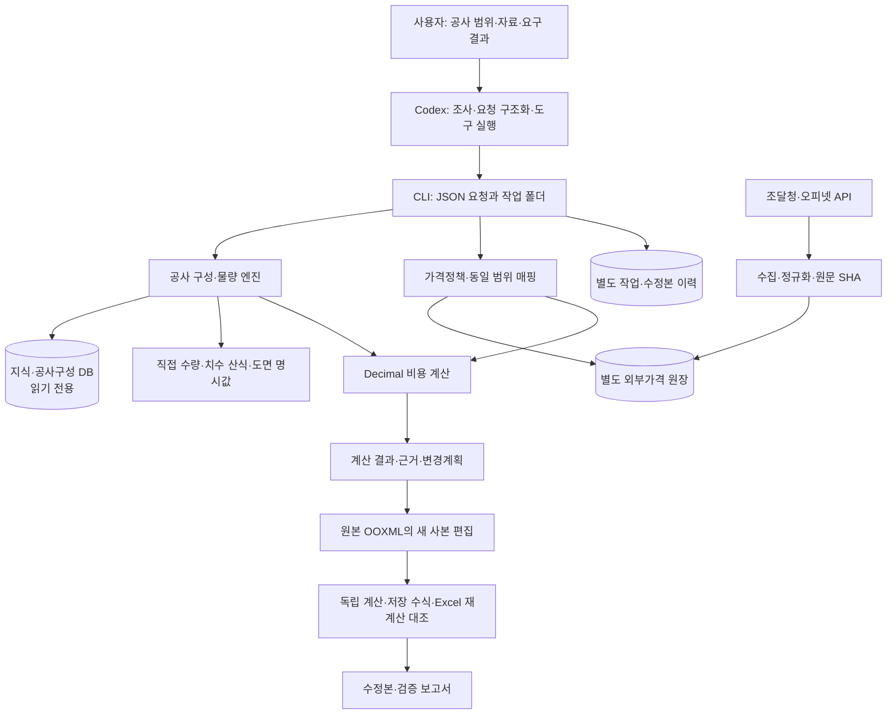

# 아키텍처와 설계 판단

시스템은 Codex가 호출하는 로컬 CLI를 중심으로 구성되어 있다. 지식 조회, 공사 구성, 물량 산출, 가격 적용, Excel 편집을 모듈로 나누고, 각 경계에 원문·판본·단위·범위 확인을 둔다.

## 모듈 지도

아래는 로컬 운영 코드의 역할이다. 공개 패키지의 `engine/`은 이 코드의 정리본이며, 실제 운영 DB와 현장자료는 별도로 제공되지 않는다. 공개 데모는 저장소의 합성 입력을 사용한다.

| 영역 | 모듈과 주요 진입점 | 맡는 일 |
|---|---|---|
| 작업 진입 | [codex_cli.py](../engine/codex_cli.py) `main`, `job_folder`, `history` | 명령 분기, 고유 작업 폴더, 요청·이력 저장 |
| 구성과 비교 | [assembly_engine.py](../engine/assembly_engine.py) `compose`, `takeoff`, `compare` | 공종 후보, 조건, 물량, 동일 범위 비교 |
| 물량 | [quantity_engine.py](../engine/quantity_engine.py) `evaluate_quantity` | 단위·차원·근거가 있는 산식 계산 |
| 비용 | [cost_engine.py](../engine/cost_engine.py) `calculate_line`, `calculate_job` | 자원 가격, 비목별 계산, 절사, 부분합 |
| 가격정책 | [pricing_policy.py](../engine/pricing_policy.py) `validate_policy`, `inherit_policy`, `validate_quote_origin` | 독립가격 우선, 원문 가격 참고 허가, 출처 계보 확인 |
| API 전송 | [api_clients.py](../engine/api_clients.py) `parse_response` 및 공급처 정의 | JSON/XML 응답, 허용 조회조건, 페이지 완결성·오류 처리 |
| 가격 원장 | [external_store.py](../engine/external_store.py) `save_snapshot`, `resolve_latest` | 원문 스냅숏과 정규화 가격, 최신판본·삭제·충돌 확인 |
| 가격 적용 | [external_pricing.py](../engine/external_pricing.py) `resolve_api_price`, `refresh_request` | 규격·날짜·세금·포장·납품조건·저장 결과 재생 검증 |
| 도면 | [drawing_extract.py](../engine/drawing_extract.py) `extract_drawing` | PDF 문자·벡터, DWG 사본의 DXF 객체와 명시 수치 추적 |
| 기존 Excel 편집 | [source_workbook_edit.py](../engine/source_workbook_edit.py) `Book`, `apply_edit` | 지원하는 행의 숫자 수정·추가와 수식·집계 보존 |
| 실제 Excel 검증 | [native_excel_validation.py](../engine/native_excel_validation.py) `verify_workbook` | 별도 검증 사본, 입력 변화·복원, SHA와 오류 대조 |

## 기술 선택

| 기술 | 선택 이유와 적용 범위 |
|---|---|
| Python | CLI, 데이터 조사, 정책 검증, 계산과 문서 처리의 공통 실행 환경 |
| SQLite | 로컬 데이터 조회와 출처 관계 보존, 작업 이력 분리 |
| Decimal | 이진 부동소수점 대신 명시된 십진 계산과 원 미만 절사 적용 |
| Python AST | 허용된 산식만 해석하고 변수·단위 차원을 확인 |
| lxml·ZIP·openpyxl 수식 도구 | 원문 OOXML 구조와 수식 참조를 좁게 편집·분석 |
| PyMuPDF | 지정 PDF 영역의 문자·벡터와 단위 추출 |
| Node.js ESM | 신규 Excel 출력 모듈 실행 |
| PowerShell·Excel COM | 설치된 Microsoft Excel에서 별도 사본 재계산 |
| AutoCAD Core Console | 설치된 환경에서 DWG 사본을 DXF로 변환하는 선택 경로 |

로컬 실행 기록은 Python 3.12 기반이다. Excel COM·DPAPI·AutoCAD 경로는 Windows 및 해당 프로그램 설치에 의존한다. 신규 Excel 출력은 Codex 번들의 `@oai/artifact-tool`을 사용하는 부분이 있어 일반 Python 설치만으로 모든 출력 기능을 재현할 수 있다고 보장하지 않는다. 공개 데모와 로컬 운영 기능의 실행 조건을 구별해야 한다.

## 1. 기준 데이터와 변경 이력을 분리

지식 DB와 공사구성 DB는 읽기 전용으로 연다. 수정 요청과 신규 결과는 별도 작업이력 DB와 고유 작업 폴더에 기록한다. 외부가격 수집은 독립 원장에 스냅숏과 계보를 추가하고, 일반 조회는 읽기 전용 경로를 쓴다.

이 구분으로 계산 과정이 기준 데이터를 몰래 교정하는 일을 줄이고, 작업 전후 SHA256 비교가 가능해진다. 외부 원장은 후속 수집으로 바뀔 수 있으므로 그 SHA는 검증 시점의 상태를 나타낸다.

## 2. 독립가격과 기존 문서 가격을 구별

기본 정책은 `EXTERNAL_PRIMARY`다. 기존 내역서 가격은 위치와 변경 전 금액을 확인하는 감사 자료로 남지만 신규가격의 자동 대체값으로 쓰지 않는다.

실제 사용자가 참고를 지시한 경우에만 상위 요청에 그 지시를 기록한다. 자식 계산은 허가를 새로 만들 수 없다. 견적을 새 JSON으로 감쌌더라도 상위 출처가 기존 내역서이면 가격 계보 검사가 이를 확인한다.

## 3. 최신가격은 단순한 날짜 정렬이 아니다

`resolve_latest`는 같은 품목·API 작업·경제적 조건의 판본을 비교한다. 최신판본을 먼저 정한 뒤 삭제·누락 여부를 확인한다. 삭제된 최신가격을 제외하고 예전 값을 다시 현재가격으로 쓰는 우회를 막기 위한 순서다.

날짜만 같아도 규격·단위·지역·납품조건·계약이 다르면 같은 가격으로 취급하지 않는다. 현재 조회와 과거 완료 결과 재생도 분리한다. 재생에는 원래 결과, 적용일, 물량, 가격 ID, 매핑과 근거가 일치해야 한다.

## 4. 계산을 모델의 자유 출력에 맡기지 않기

물량 산식은 변수·십진수·괄호와 사칙연산을 허용한다. 함수 호출이나 자유 Python 코드는 실행하지 않는다. 산식 노드 수와 중첩을 제한하며, 길이와 면적을 더하는 식처럼 차원이 맞지 않으면 차단한다.

비용 계산은 자원별 가격과 계수, 기준량, 명시된 절사를 사용한다. 자료가 없으면 미완성 상태와 부분합을 반환한다. AI가 요청을 정리하는 단계와 계산기가 숫자를 산출하는 단계를 분리한 이유다.

## 5. 편집 범위를 좁히고 검증을 분리

기존 내역서를 새 양식으로 다시 만드는 대신 지원되는 OOXML 항목만 수정한다. 숫자 말단 행과 가산 관계가 확인된 추가 행이 대상이다. 복잡한 표·배열수식·미해결 의존관계 등 지원 범위를 벗어나면 차단한다.

Excel 검증은 납품본을 직접 바꾸는 작업과 분리한다. 별도 사본에서 링크 갱신과 매크로를 차단하고, 검사할 셀을 재계산한다. 입력값 변화와 원복, 신규 오류, 납품본 SHA 보존까지 검사한다. 다만 외부링크가 미확인인 파일의 일부 셀 통과를 전체 통합문서 검증으로 확대하지 않는다.

## 6. 도면은 명시 수치와 판본을 우선

PDF의 지정 영역과 CAD 객체 handle을 근거로 추적한다. 파일 SHA와 표제·판본·단위를 확인하며, 눈대중 길이나 판본이 맞지 않는 도면을 확정 물량으로 승격하지 않는다. 등록 공사 유형이 있다는 사실도 모든 부재를 자동으로 산출할 수 있다는 뜻은 아니다.

검증 상태와 남은 한계는 [validation.md](validation.md)에 정리했다.
