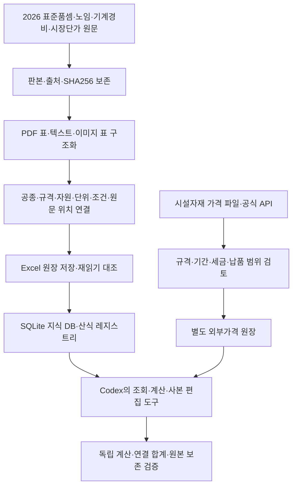

# 적산 데이터를 직접 구축한 과정

AI가 적산 업무를 수행하려면 계산할 자료와 적용 규칙부터 준비해야 했다. 2026년 표준품셈과 가격자료를 파일로 보관하는 데서 멈추지 않고, **Codex를 활용해 원문을 구조화하고 공종·자원·단가·산식을 연결한 데이터 원장과 SQLite DB를 직접 구축하는 과정**을 진행했다. 이렇게 만든 데이터를 AI가 조회하고 도구로 계산·문서 편집에 사용할 수 있도록 연결했다.

핵심은 **표준품셈 전편을 수집·구조화한 뒤, 원문에서 의미와 단위를 확인한 계수·산식을 실행 가능한 형태로 만드는 것**이었다. 전편의 자료 수록과 자동 계산 검증을 단계별로 진행했다.

## 데이터 구축의 전체 흐름

## 1. 표준품셈 982쪽 전편을 자료로 만들기

2026년 건설공사 표준품셈 PDF **982쪽 전체**의 원문을 추출하고, 공통·토목·건축·기계설비·유지관리의 공종과 규격을 구조화했다. 본문만 검색하는 대신 표의 행·열, 자원 이름과 계수, 기준량, 생산량, 주석과 조건을 연결하는 방식으로 정리했다.

이미지로만 된 표와 분수·기호가 있는 부분은 화면과 숫자 위치를 확인했다. 여러 쪽에 이어진 표는 같은 공종의 연속표인지 확인하고, 동일 숫자가 반복되어도 직종·규격·작업 단계가 다르면 별도 레코드로 유지했다. 일당 작업조의 인원수나 생산량을 자원 투입계수로 잘못 읽지 않도록 분리했다.

| 전편 구조화 기록 | 수량 |
|---|---:|
| 원문 페이지 | 982쪽 |
| 원문 블록 | 33,259개 |
| 원문 표셀 | 54,897개 |
| 표 목록 | 2,329개 |
| 공종 | 1,095개 |
| 규격 변형 | 5,987개 |
| 활성 자원투입 | 11,850개 |

이 수치는 2026년 10월 구축·검토 기록의 자료 규모다. 표셀이나 규격 변형의 개수를 완성된 계산식 개수로 세지 않았다.

## 2. 숫자와 원문 사이의 연결을 보존하기

구조화 과정에서 공종 ID, 규격 변형 ID, 자원 ID, 투입 ID를 부여하고 각 값에 원문 PDF쪽과 표·행·열 위치를 연결했다. 가격자료에는 별도의 가격 ID와 적용일·단위·포함 범위를 연결했다. 이 구조 덕분에 계산 결과에서 사용한 자원과 원문 위치로 거슬러 올라갈 수 있다.

같은 숫자라도 기준량을 잘못 읽으면 비용이 크게 달라진다. 예를 들어 `km당` 계수를 `m당` 계수로 읽은 경우에는 단위 이름만 바꾸지 않고 기준량을 `1,000m`로 함께 교정했다. 품셈의 원문 값, 추출한 값, 검토 후 교정값을 따로 보관했다.

정오표도 별도 판본으로 관리했다. 파일별 SHA256과 페이지별 차이를 확인하고, 원판의 좌표·ID를 정오표 반영판에 그대로 섞지 않았다. 교정은 원문을 덮어쓰는 방식이 아니라 **근거가 붙은 오버레이**로 기록했다.

## 3. 원장과 계산용 DB를 연결하기

처음 구조화한 내용은 검토할 수 있는 Excel 원장으로 저장했다. 표준품셈 잔여 보완 단계에서는 **Excel 7개·150시트·261,630개 데이터행**을 저장한 뒤 다시 읽어 원장과 대조했다. 이 값은 해당 Excel 산출물의 규모이며, 이후 통합 DB의 `model_rows`와 같은 집계가 아니다.

이후 품셈·가격·원문 의존관계를 SQLite로 통합해 Codex가 명령으로 조회할 수 있게 했다. 원문과 교정 정보, 가격 연결과 계산 가능 상태를 함께 보관하고 기준 지식 DB는 읽기 전용으로 사용한다. 새 요청과 수정본 이력은 별도 작업 이력 DB에 남긴다.

## 4. 확인된 계수와 산식을 실행 가능하게 만들기

전편의 숫자와 식을 수록하는 것과, 그 의미를 확인해 안전하게 실행하는 것은 별도 단계다. 전체 규격 변형을 재검토한 뒤 고정계수 계산 근거가 확인된 범위와 추가 조건이 필요한 범위를 나눴다.

| 구분 | 확인한 범위 | 실행에서의 의미 |
|---|---:|---|
| 고정계수 계산 지원 | 2,556개 규격 변형·4,539개 투입 | 원문 기준량과 자원계수로 소요량을 계산할 근거 확인 |
| 미지원 규격 변형 | 3,431개 | 부족한 자원·기준량·작업모델·판본 등의 사유 보존 |
| 명시 산식 레지스트리 | 50개 산술 레코드 | 원문 변수·단위·분기·필수조건을 연결한 실행식 |
| 산식 검증 | 27개 시험 통과 기록 | 독립 손계산, 경계·누락·부적합 입력 및 금지 AST 검사 |

고정계수는 `공사량 ÷ 원문 기준량 × 자원계수`로 계산한다. 명시 산식은 제한된 AST와 Decimal로 실행하며, 임의 코드나 함수 호출은 허용하지 않는다. 분모가 0이거나 변수가 부족한 경우, 단위가 맞지 않는 경우에는 계산을 확정하지 않는다.

따라서 이 프로젝트의 성과는 **2026 표준품셈 전편을 구조화하고 검증 가능한 부분부터 실행화한 것**이다. 모든 공식의 현장 적용과 모든 공종의 완성 단가를 검증했다고 설명하지 않는다. 가격과 현장 조건이 추가로 필요한 부분은 그 상태를 유지한다.

## 5. 물가·가격자료를 함께 구축하기

품셈은 소요량의 기준이므로 금액을 계산하려면 가격자료가 더 필요하다. 2026년 노임·기계경비·표준시장단가와 제경비 자료를 구조화하고, 자재가격 입력 및 현장 참고자료를 연결하는 원장을 만들었다.

| 자료 | 기록된 규모 | 구분해서 보관한 내용 |
|---|---:|---|
| 건설업 노임 | 528행 | 132직종의 4시점 가격, 적용일과 기본급 범위 |
| 건설기계경비 | 613행 | 기계 규격·손료·운전원·연료 등 산정에 필요한 조건 |
| 표준시장단가 | 1,842행 | 공종·단위·단가와 포함·제외 조건 |
| 제경비요율 | 308행 | 기관·공사 조건·적용기간·기준금액 |
| 자재가격 입력 | 323행 | 필요한 자재와 미확보 가격을 드러내는 입력 원장 |
| 내역서·ESTX 관찰가격 | 12,912건 | 실제 문서에서 관찰한 값과 그 출처·규격·범위 |

표의 자료는 서로 같은 가격 종류가 아니다. 기계 구매가격과 시간당 운전비, 기본 노임과 추가 수당, 과거 문서의 저장가격과 현재 공급견적을 구별했다. 자재가격 입력 행이 있다고 해서 그 가격이 모두 확보된 것으로 처리하지 않았다.

이 문서에서 말하는 물가·가격자료는 적산에 쓰이는 자재·노임·장비·시장단가 자료다. 거시경제 물가지수 시계열이나 특정 유료 물가책 전체를 구축했다는 의미로 사용하지 않는다.

## 6. 부족한 가격과 갱신을 공식 API로 보완하기

초기 자료만으로 부족한 자재·연료 가격을 보완하고, 필요한 품목의 공표판본을 다시 확인하기 위해 공식 API를 연결했다. 조달청의 시설자재 가격·쇼핑몰 계약품목·물품목록 정보와 오피넷 연료가격은 각각 용도가 다르므로 분리했다.

별도 시설공통자재 파일은 **406,098행 전체**를 외부가격 원장에 보존하고 원문 필드·행 위치를 독립 대조한 기록이 있다. 삭제된 과거판본, 단가 미기재, 명시된 0원, 세금 미확인 상태도 구분했다. 전체 행을 보존하는 것과 그 행을 현재가격으로 적용하는 것은 다르다.

요청한 품목을 API로 조회하면 원문 응답과 SHA256, 조회일, 공표일, 원래 조회조건을 보존한다. 규격·단위·날짜·세금·납품 범위가 맞는 가격만 계산 자원에 연결한다. 내역서에 이미 적혀 있던 가격은 신규가격으로 자동 대체하지 않는다.

API가 가격을 제공해도 설치 생산성이나 현장 계수를 만들어 주지는 않는다. 필요한 가격이나 조건이 여전히 없으면 해당 결과는 미완성으로 남기고, 확인한 부분합과 필요한 자료를 함께 제시한다. 사용한 API와 키 설정·보관 방식은 [API 연동 문서](api-integration.md)에 정리했다.

## 데이터 구축을 AI 작업으로 이어가기

구축한 DB는 사람이 조회하는 자료집이면서 AI가 사용하는 업무 도구의 기반이다. 사용자가 공사를 설명하면 Codex가 공종·판본·물량·가격 조건을 구조화하고, 조회·계산·문서 편집 도구를 호출한다. 수치 계산은 명시한 규칙과 Decimal이 처리하고, 결과에는 사용한 근거와 검증 범위가 남는다.

즉 **데이터를 직접 구축한 뒤 AI를 연결해 소규모 적산 작업을 요청·실행할 수 있는 시스템**을 만든 것이다. 문서에서 원문을 다시 찾고 숫자를 옮기는 반복 작업을 줄이는 것을 목표로 하며, 실제 작업시간과 비용 절감률은 후속 사용자 검토에서 측정할 계획이다.

## 공개 저장소에 남기는 범위

공개 저장소에는 구현 소스, 구축 과정, 집계된 검증 결과와 합성 데모를 남긴다. 실제 원문·현장 DB·계약자료·API 원시 응답은 현장 정보와 제3자 자료의 배포 범위를 고려해 로컬에 보존한다.

이 문서의 수치와 검증은 2026년 10월의 해당 단계 기록을 요약한 것이다. 공개 데모를 실행해 실제 DB를 다시 구축하거나 모든 API 가격을 갱신하는 것은 아니다.

- [프로젝트 개요](../README.md)
- [적산 업무의 전체 맥락](context.md)
- [API 연동과 키 관리](api-integration.md)
- [검증 범위와 한계](validation.md)
