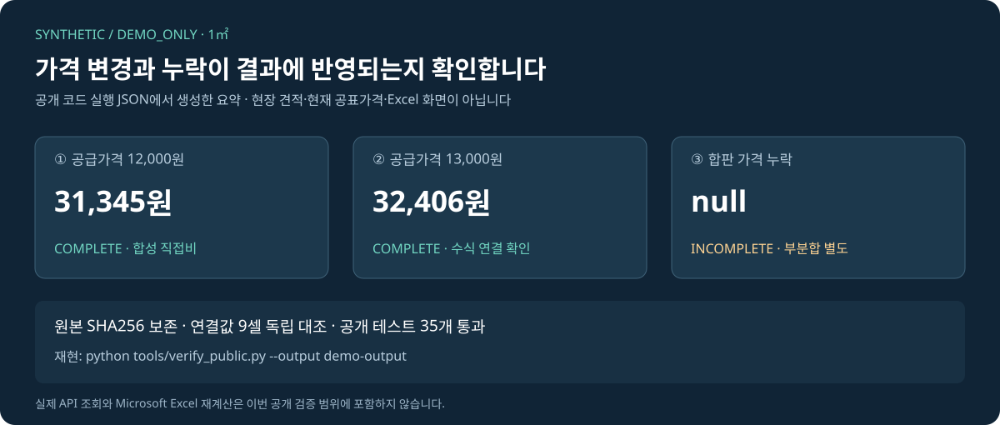

# 3분 확인 순서

처음 보는 평가자가 **요청 → 가격 확인 → 계산 → 사본 생성 → 검증**을 확인하기 위한 안내입니다. 공개 축소 데모는 12mm 합판 설치 1㎡와 명시된 직접비 범위만 지원합니다. 자연어 요청 조율은 실제 작업의 Codex 세션이 담당하고, 이 저장소의 데모는 합성 JSON을 CLI로 실행합니다.

## 1. 결과부터 보기



| 조건 | 실행 결과 | 확인할 점 |
|---|---|---|
| 합판 공급가격 12,000원 | 합성 직접비 31,345원 | 재료·노무·경비를 Decimal과 명시적 절사로 계산 |
| 공급가격을 13,000원으로 변경 | 합성 직접비 32,406원 | 손실·고정재·상위 집계까지 가격 변화가 전달됨 |
| 합판 가격 누락 | `INCOMPLETE`, `total: null`, 확인 부분합 18,615원 | 누락을 0원이나 완성 금액으로 대체하지 않음 |

가격과 계수는 모두 `SYNTHETIC / DEMO_ONLY`입니다. 실제 사례의 31,092원은 [2026-10-06 당시 조건의 별도 추정](case-study.md)이며 이 데모의 값과 구별합니다.

## 2. 직접 재현하기

Python 3.10 이상과 표준 라이브러리만 있으면 됩니다. API 키·고객 자료·Microsoft Excel 설치는 필요하지 않습니다.

```bash
git clone https://github.com/gimd34939-jpg/construction-cost-agent.git
cd construction-cost-agent
python tools/verify_public.py --output demo-output
```

이 명령은 테스트, Python 구문, 공개 엔진 23개 파일의 매니페스트 해시, 문서의 상대링크 파일 존재 여부를 검사한 뒤 새 폴더에 다음 파일을 만듭니다. 기존 출력 폴더가 있으면 다른 이름을 사용해야 합니다.

| 생성 파일 | 확인할 내용 |
|---|---|
| `result.json` | 정상·가격 누락·가격 변경 결과와 연결 셀별 실제값/예상값 |
| `synthetic_original.xlsx` | 합성 기준 입력과 수식 |
| `synthetic_repriced.xlsx` | `Prices!B2`를 13,000원으로 바꾼 새 사본 |
| `public-checks.json` | 실행 환경, 시험 건수, 구문·링크·소스 해시 검사와 코드 SHA256 |
| `demo-result.svg` | 해당 실행 JSON에서 생성한 결과 요약 그림 |

`result.json`의 `workbook_verification`에서 `source_unchanged`, `formulas_preserved`, `check_count: 9`와 각 `passed`를 확인합니다. 이 검사는 제한된 OOXML 수식 평가와 독립 계산의 대조입니다. 실제 Microsoft Excel 재계산이나 전체 도급액 검증은 포함하지 않습니다.

설치 없이 결과 파일을 살펴보려면 [GitHub Actions](https://github.com/gimd34939-jpg/construction-cost-agent/actions)에서 이 검증을 실행한 완료 항목의 `synthetic-demo-python-*` 아티팩트를 내려받을 수 있습니다. 보관 기간은 14일입니다. GitHub 로그인은 다운로드에 필요할 수 있습니다.

## 3. 설명과 구현 대조하기

| 보고 싶은 판단 | 근거 위치 |
|---|---|
| 본인과 AI가 각각 맡은 역할 | [포트폴리오](portfolio.md#본인이-주도한-부분과-ai의-기여) |
| 합판 외 공종·포함범위의 완성 오표시 차단 | [공개 데모 계산기](../demo/costing.py), [회귀테스트](../tests/test_demo.py) |
| 실제 엔진의 혼합단위·누락·위험 AST 처리 | [실제 엔진 오프라인 시험](../tests/test_engine_public.py) |
| 전체 시스템과 공개 데모의 실행 조건 차이 | [엔진 실행 범위](../engine/README.md) |
| 대규모 데이터·과거 Excel 검증의 확인 경계 | [검증과 한계](validation.md) |

현재 검증 결과를 문서와 그림에 갱신하는 관리 명령은 다음과 같습니다. 성공한 출력 내용을 검토한 뒤 변경사항을 커밋합니다.

```bash
python tools/verify_public.py --output demo-output-review --report docs/public-checks.json --preview assets/demo-result.svg
```
